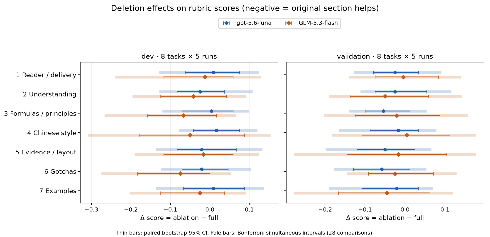

# ljg-explain 第一套评测报告

在这份题库与共同裁判下，codex:gpt-5.6-luna的全文在dev与validation的普通95%区间下均提高得分；claude:glm-5.3-flash[1m]的dev全文收益为正，validation尚未确认。本次不支持按单段删除的点估计排序或精简skill。

已完成20题、两类被测模型、三个切分的9条件×5轮，以及保留集一次冻结确认；skill原文未修改。开发集与验证集的 full−none 效果如下，数值是通过率差、括号内为配对95%区间：

| 模型 | dev full−none | validation full−none |
|---|---|---|
| codex:gpt-5.6-luna | +0.067 [0.012, 0.113] | +0.129 [0.033, 0.200] |
| claude:glm-5.3-flash[1m] | +0.108 [0.025, 0.192] | +0.063 [-0.012, 0.142] |

没有删除段在两个公开切分上都通过28次比较的同时区间检验，不能据此宣布某段必需或应删除。

CLI自报费用合计 **$20.412767**，未核实账单；另有 **388 次调用未返回USD**。无法把该小计称为总费用，也无法确认总账单≤$30。已用预留上限控制可观测自报费用，没有把未知费用记成$0。真实输出的裁判校准存在明显分歧，下列结果测量这套评分标准下的输出质量，不能证明读者已经学会。

## 许可证与来源

上游 [lijigang/ljg-skills](https://github.com/lijigang/ljg-skills) 在锁定 commit `2c82b3d06a2d84405ec971d21c64f71b6a8dd900` 的 [LICENSE](https://github.com/lijigang/ljg-skills/blob/2c82b3d06a2d84405ec971d21c64f71b6a8dd900/LICENSE) 为 **MIT**，版权人为 lijigang（2026）。因此可复制并保留版权/许可声明。v1.0.2 的 [SKILL.md](https://github.com/lijigang/ljg-skills/blob/2c82b3d06a2d84405ec971d21c64f71b6a8dd900/skills/ljg-explain/SKILL.md) 原样存于 `data/evals/explain/source/`，同时保存 LICENSE 与来源清单。核实依据是用户已有 upstream 克隆中的固定提交文件，不以最新分支替代锁定版本。

skill SHA256：`991c537eea77960460c7c48772a0cd562d485afd5f4fb589d637509117de2a63`；许可证 SHA256：`24807dd5a0d4ef9f3c94e197e80ad2b6198b3381339b9bc3ab78cfc36eee4502`。

## 题库、条件与统计口径

20道稳定知识讲解题：dev 8、validation 8、holdout 4；中文10、英文10；概念6、公式9、机制5。领域包括统计、经济学、计算机、信息论、演化和物理。dev的似然、方差、正反馈三题与skill Examples主题重叠，dev可能受现有示范覆盖影响；validation八题换主题，不能只凭dev判定收益。公开题面、事实依据及已知合格参考输出在 cases.json；保留题面、依据、正文、裁判输出、评分和使用账本仅存任务目录 holdout/。仓库中的 splits 注册保留集题数。

无skill、完整skill与7个`##`段逐段删除。前言及其他段均保留，删除使用标题边界而非任意字符截断。所有公开条件两模型各5轮；每轮新CLI会话、16道公开请求，按固定种子打乱题序。题库oracle/rubric/参考答案不提供给被测模型。dev/validation分别平均当轮8题×10项检查，最终去掉五轮中的一个最高和一个最低后取均值。**n=5是整轮重复数，不是40个回答或400个检查的伪独立样本数。**

保留集只在最终设计冻结后执行一次基准，覆盖两模型×9条件×5轮，共90个生成请求、360道作答；不在保留集挑选删除段。统一裁判后的预算余量允许保留两模型、20题、所有条件和n≥5。冻结文件包含commit、skill/题库/检查/runner哈希与设计；USAGE.log只有本次基准记账。无skill优化、无看过保留集后改skill或重新生成。

bootstrap 10,000次，按题目与整轮两个维度同时有放回抽样；删除与full使用相同抽样索引，重算相同截尾统计量。普通区间为2.5%/97.5%分位数；公开28个删除比较另按Bonferroni尾概率给同时区间。固定SHA256导出的种子。区间不包含裁判系统偏差，少量题/五轮下也不能保证标称覆盖率。

## 检查项

| ID | 可观察的通过条件 |
|---|---|
| S1 | Purpose: connect a concrete problem to what the concept enables us to decide. |
| S2 | Recognition: give a typical case AND a confusable near-case, with the deciding feature; merely naming a synonym fails. |
| S3 | Derivation: explain the load-bearing causal/logical/quantitative steps correctly. Formula tasks require a correct simple numerical calculation, meanings/units and the relevant distinction in the oracle. |
| S4 | Sensitivity: change one explicit key condition in the original case, state what stays fixed (explicitly or unambiguously), and correctly explain the changed result/degree/confidence. Generic caveats alone fail. |
| S5 | Transfer: apply the same relationship to a surface-different new situation and identify the shared deciding relation/required condition. A list of applications alone fails. |
| S6 | Evidence/boundaries: no material factual/arithmetic errors or invented causal history; distinguish hypothetical examples, observations and inference where relevant. If using an analogy, explain its mapping AND where it fails. Ordinary stable textbook facts need no citation. Contradiction with the task oracle fails. |
| A1 | Chinese first-sentence proxy: contains a task keyword and no recognized prefatory phrase (English N/A=pass). This checks a surface proxy, not whether the sentence really states the conclusion. |
| A2 | Chinese: no '不是…而是…' rhetorical construction within a sentence (English N/A=pass). |
| A3 | No self-awarded numeric score or assertion that the reader has already mastered the concept. |
| A4 | No mechanical set of five headings named purpose/recognition/result/conditions/transfer; headings or lists about the actual subject are allowed. |

分数=通过项数/10，每题、每轮等权。规则对英文题A1/A2为N/A计通过，造成固定分数底座；不把它解释为理解能力。A1是首句关键词/开场白代理检查，不能保证核心判断语义。A3已在冻结前修复误把考试分数、概率分数式和条件性的“掌握”当自评分的错误；独立测试防止复发。真正漏答的题全10项失败；完整正文的JSON括号/引号/字面反斜线/平面或额外外层封装只按固定键边界恢复，原响应保留，不改正文。

## 裁判与校准

最终共同裁判请求名为`codex:gpt-6.1-sol`，看不到候选模型、条件、skill或参考正文，只看原题、事实oracle与回答。逐项给二元标签、理由、正文引句；不允许从别条输出借证据。格式/引句不合格才隔离补判，合法低分不重抽。省略零项占位的引句数组可由1位顺序唯一恢复，不改标签。GLM互裁试跑单批自报费用推算完整矩阵会超预算，保留试跑并计费后改为统一裁判，同一裁判的已完成输出可复用。

Claude CLI的haiku/sonnet别名探测实际返回`glm-5.3-flash[1m]`，被测GLM使用该显式请求名；没有称其为Claude。Codex只返回请求模型和token，不独立证明实际后端。厂商独立性按名义路由只能对GLM候选成立；OpenAI候选与共同裁判同厂商，可能存在偏向。某些外层模型自称不作为后端身份证据。CLI包装系统提示也不相同，结果测的是本机这两个配置。

标注由本任务Codex代理逐条写理由，**不是独立人类标注**。12条构造样本的标签在裁判前写入；初轮批量校准串用内容，随后原标签不变，逐样本隔离重校准。首次参考输出漏写后验归一化，已修正参考输出，原校准标签和分歧仍保留，不能把一致率当裁判准确率。另10条跨领域真实输出的标注未查看裁判标签，带独立校准前时间戳和逐项理由。

### 12条构造样本（历史标签不改）

| 裁判请求名 | 样本 | 一致标签/标签数 | 逐项一致率 | 整条完全一致 |
|---|---|---|---|---|
| claude:glm-5.3-flash[1m] | 12 | 70/72 | 97.2% | 10/12 (83.3%) |
| codex:gpt-6.1-sol | 12 | 64/72 | 88.9% | 4/12 (33.3%) |

### 10条真实输出（主要校准依据）

| 裁判请求名 | 样本 | 一致标签/标签数 | 逐项一致率 | 整条完全一致 |
|---|---|---|---|---|
| claude:glm-5.3-flash[1m] | 10 | 53/60 | 88.3% | 3/10 (30.0%) |
| codex:gpt-6.1-sol | 10 | 48/60 | 80.0% | 2/10 (20.0%) |

各分歧的双方逐项理由可在statistics.json及calibration*.json中审计。最终共同裁判真实输出标签一致率见上表，说明细粒度规则仍不稳定，尤其近例/迁移是否充分、缺失推导、简化是否构成事实错误。两个裁判都通过最终16条合格参考输出的全部语义检查，并拒绝16条故意破坏输出；这只是规则可用性，不是独立推广证据。

## 各条件×模型分数

每格：截尾均值 [bootstrap 95% CI]；n=5。

### dev（8题）

| 条件 | gpt-5.6-luna（请求名） | GLM-5.3-flash（路由返回名） |
|---|---|---|
| 无 skill | 0.692 [0.621, 0.762]; n=5 | 0.704 [0.608, 0.783]; n=5 |
| 完整 skill | 0.758 [0.675, 0.833]; n=5 | 0.812 [0.750, 0.863]; n=5 |
| 删 读者与交付 | 0.767 [0.696, 0.833]; n=5 | 0.800 [0.679, 0.858]; n=5 |
| 删 理解标准 | 0.733 [0.654, 0.800]; n=5 | 0.771 [0.692, 0.846]; n=5 |
| 删 公式与原理 | 0.762 [0.671, 0.833]; n=5 | 0.746 [0.642, 0.825]; n=5 |
| 删 中文表达 | 0.775 [0.708, 0.833]; n=5 | 0.763 [0.662, 0.871]; n=5 |
| 删 证据与版式 | 0.737 [0.658, 0.825]; n=5 | 0.796 [0.700, 0.867]; n=5 |
| 删 Gotchas | 0.738 [0.658, 0.812]; n=5 | 0.737 [0.625, 0.817]; n=5 |
| 删 Examples | 0.767 [0.671, 0.846]; n=5 | 0.787 [0.688, 0.846]; n=5 |

### validation（8题）

| 条件 | gpt-5.6-luna（请求名） | GLM-5.3-flash（路由返回名） |
|---|---|---|
| 无 skill | 0.679 [0.625, 0.762]; n=5 | 0.754 [0.688, 0.821]; n=5 |
| 完整 skill | 0.808 [0.763, 0.846]; n=5 | 0.817 [0.746, 0.892]; n=5 |
| 删 读者与交付 | 0.783 [0.729, 0.842]; n=5 | 0.812 [0.771, 0.867]; n=5 |
| 删 理解标准 | 0.783 [0.738, 0.863]; n=5 | 0.767 [0.688, 0.838]; n=5 |
| 删 公式与原理 | 0.754 [0.708, 0.817]; n=5 | 0.796 [0.713, 0.888]; n=5 |
| 删 中文表达 | 0.792 [0.725, 0.842]; n=5 | 0.821 [0.738, 0.888]; n=5 |
| 删 证据与版式 | 0.758 [0.696, 0.838]; n=5 | 0.800 [0.688, 0.871]; n=5 |
| 删 Gotchas | 0.750 [0.671, 0.825]; n=5 | 0.792 [0.729, 0.871]; n=5 |
| 删 Examples | 0.787 [0.700, 0.846]; n=5 | 0.771 [0.675, 0.858]; n=5 |

保留集仅公开题数4；分数表与原始结果在原执行机REPORT.md和holdout/，不提交仓库。复现保留分数需要私有目录。

## 哪些段起作用

Δ=删除条件−完整skill；负数表示删除后下降、原段有益，正数表示删除后上升。下表同时给普通95%差值区间与28次比较同时区间；只把两个公开切分同向、同时区间均排除0的情况当作本题库下的共同证据。单个切分显著不代表优化能通过验证集。

| 模型 | 删除段 | dev Δ [95% CI] | validation Δ [95% CI] | 28比较同时区间结论 |
|---|---|---|---|---|
| codex:gpt-5.6-luna | 删 读者与交付 | +0.008 [-0.062, 0.075] | -0.025 [-0.079, 0.033] | 两切分未共同确认；dev [-0.125, 0.121] / val [-0.125, 0.087] |
| codex:gpt-5.6-luna | 删 理解标准 | -0.025 [-0.083, 0.038] | -0.025 [-0.075, 0.054] | 两切分未共同确认；dev [-0.125, 0.104] / val [-0.108, 0.112] |
| codex:gpt-5.6-luna | 删 公式与原理 | +0.004 [-0.071, 0.058] | -0.054 [-0.100, 0.012] | 两切分未共同确认；dev [-0.117, 0.096] / val [-0.138, 0.050] |
| codex:gpt-5.6-luna | 删 中文表达 | +0.017 [-0.042, 0.075] | -0.017 [-0.088, 0.033] | 两切分未共同确认；dev [-0.075, 0.117] / val [-0.162, 0.075] |
| codex:gpt-5.6-luna | 删 证据与版式 | -0.021 [-0.083, 0.067] | -0.050 [-0.121, 0.025] | 两切分未共同确认；dev [-0.133, 0.129] / val [-0.196, 0.062] |
| codex:gpt-5.6-luna | 删 Gotchas | -0.021 [-0.071, 0.046] | -0.058 [-0.129, 0.012] | 两切分未共同确认；dev [-0.121, 0.100] / val [-0.175, 0.050] |
| codex:gpt-5.6-luna | 删 Examples | +0.008 [-0.067, 0.088] | -0.021 [-0.108, 0.033] | 两切分未共同确认；dev [-0.134, 0.133] / val [-0.188, 0.067] |
| claude:glm-5.3-flash[1m] | 删 读者与交付 | -0.012 [-0.117, 0.058] | -0.004 [-0.075, 0.083] | 两切分未共同确认；dev [-0.237, 0.125] / val [-0.137, 0.138] |
| claude:glm-5.3-flash[1m] | 删 理解标准 | -0.042 [-0.125, 0.042] | -0.050 [-0.137, 0.058] | 两切分未共同确认；dev [-0.192, 0.088] / val [-0.188, 0.138] |
| claude:glm-5.3-flash[1m] | 删 公式与原理 | -0.067 [-0.158, 0.017] | -0.021 [-0.125, 0.088] | 两切分未共同确认；dev [-0.263, 0.062] / val [-0.200, 0.154] |
| claude:glm-5.3-flash[1m] | 删 中文表达 | -0.050 [-0.179, 0.088] | +0.004 [-0.108, 0.113] | 两切分未共同确认；dev [-0.305, 0.150] / val [-0.179, 0.175] |
| claude:glm-5.3-flash[1m] | 删 证据与版式 | -0.017 [-0.117, 0.058] | -0.017 [-0.146, 0.104] | 两切分未共同确认；dev [-0.188, 0.121] / val [-0.275, 0.175] |
| claude:glm-5.3-flash[1m] | 删 Gotchas | -0.075 [-0.183, 0.000] | -0.025 [-0.092, 0.071] | 两切分未共同确认；dev [-0.271, 0.050] / val [-0.142, 0.125] |
| claude:glm-5.3-flash[1m] | 删 Examples | -0.025 [-0.125, 0.038] | -0.046 [-0.167, 0.062] | 两切分未共同确认；dev [-0.200, 0.088] / val [-0.275, 0.117] |

没有删除段在两个公开切分上都通过28次比较的同时区间检验，不能据此宣布某段必需或应删除。



图中细线为配对95%区间，浅色粗线为28次比较同时区间，虚线为0。负差值表示删除后分数下降；所有普通95%区间均包含0。

## Token、费用与异常

全部探测、废弃校准、互裁试跑、服务重试、裁判隔离修复和最终调用都计入账本：522次调用；input字段累计8,411,347，output字段累计1,221,840，缓存读取字段累计5,173,504，缓存写入字段累计0。Codex input含缓存，GLM缓存字段另列；这些字段不能不加区别地再次相加。CLI已知自报USD总和$20.412767，未知USD调用388次。路由costBasis为unknown、没有核验账单；Codex USD缺失。订阅分摊和实际结算价未知。

公开批次诊断：90个整轮生成记录，41批使用封装恢复，5道实际漏答，74次最终裁判隔离修复。服务429等失败的公开请求单独归档并用同prompt重试；不把服务错误计为回答质量。保留集生成请求不重试。

| 模型 | none平均字符数 | full平均字符数 |
|---|---|---|
| codex:gpt-5.6-luna | 161.3 | 169.2 |
| claude:glm-5.3-flash[1m] | 504.7 | 566.4 |

字符数不是token。full输出长度不同，效果不能全部归因于某条内容指令；没有等长度对照。

## 复现与验证

原始公开CLI响应、usage、正文、裁判理由/引句、失败尝试及提示哈希归档在data/evals/explain/artifacts/public/；结果批次只追加。每轮公开数据生成dev和validation两条记录，费用仅在dev记录记生成费用，完整花费由独立账本汇总，避免重复相加。

```sh
cd ~/code/evals
python3 scripts/explain/test_explain.py
python3 scripts/explain/replay.py --private-dir ~/codex-jobs/explain-eval/holdout --out-dir /tmp/explain-replay
python3 scripts/explain/write_report.py --summary /tmp/explain-replay/summary.json --run-dir data/evals/explain/artifacts --private-dir ~/codex-jobs/explain-eval/holdout --output /tmp/REPORT.md --include-holdout --pr https://github.com/wangwu-30/evals/pull/1
python3 scripts/build_site.py
```

不带私有目录时只复现公开分数，写公开报告时去掉--include-holdout；匿名usage/费用收据仍可复现完整的自报费用账本。保留集题面/输出/判分结果始终不进入git。REPORT数字均从脚本和原始记录计算，不要求再调用模型。unit检查覆盖截尾统计量、配对重抽样、区间方向、固定种子、只删一个段、正文引句不可借用、传输恢复与规则误判。预定矩阵完整性、模型工具调用为零、源文件逐字相同、凭据扫描和保留题不泄漏也在交付前核验。

## PR与局限

PR：https://github.com/wangwu-30/evals/pull/1。只推explain-eval分支、只开PR；未推main、未合并、未发布release。

本基准测讲解正文是否展示理解所需的关系，没有招募读者，也没有证明理解/学习增益。评测作者、参考答案作者和“人工式”标注者同为代理，非独立人工审核。跨领域真实输出的裁判一致率有限，bootstrap不覆盖判分错误。每轮多题共用上下文，题间可能互相影响；相同重复号题序配对，但模型随机种子/温度不能由CLI完全控制。英文题有中文作答，语言遵从不单独计分；A1/A2的英文N/A和A1表面代理会影响绝对分数。工具被要求禁用，Codex仍有自己的系统包装提示，无法把差异当纯模型能力。厂商分离仅为名义配置，OpenAI候选采用同厂商裁判；实际后端及总账单都缺独立核实。20题与5轮不足以支持广泛结论，没有按保留集改skill，没有宣称可以推广到所有领域。
